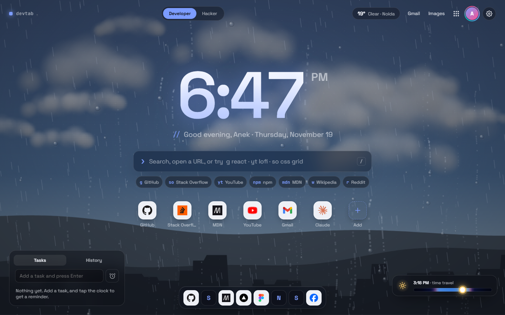
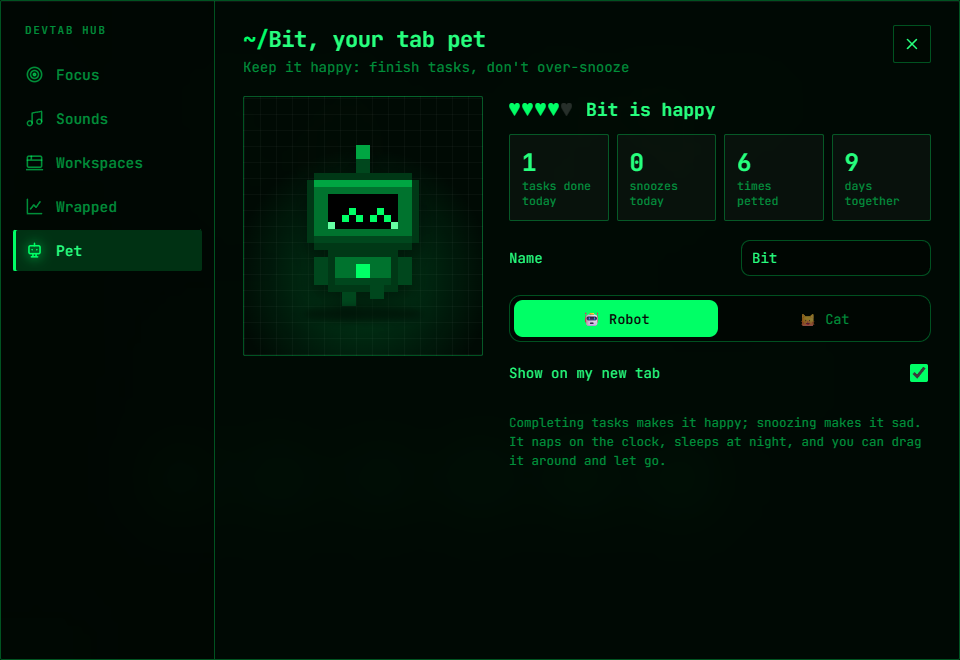
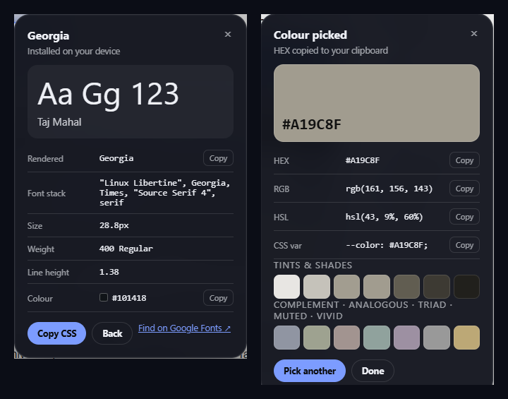

# DevTab

A new tab page for developers, with two looks: **Developer** and **Hacker**. A live sky with your city's real weather, your GitHub year as a 3D city, a clock made of particles, and a page that falls apart when you shake the mouse. Plus the useful stuff: focus mode that blocks distracting sites, ambient sounds, workspaces, a browsing Wrapped, a tab pet, page tools (colour picker, image size and font finder), shortcuts with real site icons, a bookmarks dock, and reminders that ring.

**[Try the live demo →](https://anekkumar9518.github.io/devtab/)** (it runs in any browser; installing the extension makes it your new tab and unlocks the features that need it)


## What's new in 2.0

### Backgrounds that are alive
- **Live sky.** The real weather and the real sun for your city. Rain streaks and drops sliding down the glass, snow, fog, lightning in a thunderstorm, clouds that drift with the actual wind. The sky follows the real sunrise and sunset, with stars and a moon at night and lit windows in the city skyline.
- **Time travel.** Drag the slider and the sky moves through the day: dawn, noon, sunset, midnight. Let go and it glides back to now.
- **GitHub city.** Your last year of contributions as a night skyline: every day is a building, and busier days are taller. It turns slowly, and pointing at a building lights it up with "May 10, 2026: 20 contributions".
- **3D parallax.** Every background shifts in layers as you move the mouse (or tilt your phone), like a window into another world.




### Effects
- **Particle clock.** The digits are thousands of glowing dots. Move the cursor through them and they scatter like sand, then flow back. In the Hacker look they're falling Matrix characters.
- **Gravity mode.** Shake the mouse hard, or type `gravity`, and the whole page falls down. Grab things and throw them; they bounce and tumble. Double-click and everything flies back.
- **Launch scenes.** Opening a site plays a 0.7-second scene: a play button rushing past for video sites, contribution squares for GitHub, an envelope for mail, a warp tunnel with the site's icon for anything else. Type just `youtube`, `github` or the name of one of your shortcuts to open it.


### The Hub (press <kbd>H</kbd> or <kbd>Ctrl</kbd>+<kbd>K</kbd>)
- **Focus mode.** Pick 15 to 90 minutes (or any length) and start. YouTube, Instagram and the other sites on your list turn into an "Access denied" page until the timer ends, with a countdown badge on the toolbar icon. Ending early takes a deliberate 2.5-second hold.
- **Ambient sounds.** Rain, café, keyboard, server room, ocean waves and a fireplace, generated live in the browser (nothing is downloaded), each with its own volume. Ready-made mixes and a sleep timer. It keeps playing on every tab until you pause it.
- **Workspaces.** Save all the tabs in a window as "Client work" or "Learning", then reopen the whole set in one click.
- **Wrapped.** Tabs opened, time per site, your busiest hour, longest focus session and tasks done, for today, 7 or 30 days, and a shareable card. Opt-in, and it never leaves your browser.
- **Tools.** A colour picker that works anywhere on your screen, and an image inspector you can drop files on.
- **Your pet.** See how it's doing, rename it, or switch between the robot and the cat.


### Your tab pet
A pixel robot (or cat) lives at the bottom of the page. It walks around, naps on the clock, sleeps at night, watches your cursor, cheers when you complete a task and sulks when you snooze. Leave it for days and it gets dusty; click it to clean it. You can pick it up and throw it.



### "What was I doing?"
After Chrome restarts, the first new tab shows what you were working on last time (your in-progress task, or the page you were on) and brings all your tabs back in one click.

### Page tools, on any website
Click the DevTab button in the toolbar, or use a shortcut:
- <kbd>Alt</kbd>+<kbd>Shift</kbd>+<kbd>1</kbd> **Colour picker:** the page freezes, a magnifier follows the cursor, and a click copies the exact pixel's HEX with RGB, HSL and a palette.
- <kbd>Alt</kbd>+<kbd>Shift</kbd>+<kbd>2</kbd> **Image size finder:** hover any image (even CSS backgrounds) to see its real resolution next to the size it's shown at, whether it's blurry or oversized, its format, file size and alt text. "All images" lists every image on the page, largest first.
- <kbd>Alt</kbd>+<kbd>Shift</kbd>+<kbd>3</kbd> **Font finder:** hover text to see the font that's actually rendered (not just the CSS list), its size, weight, line height and colour, with a live sample and "Copy CSS".



Everything above can be switched on or off in Settings.

## Everything else
- **Two looks.** Developer: glass panels, a soft glowing clock, an aurora background. Hacker: green monospace, Matrix rain, a glitching clock, CRT scanlines and a short boot sequence. Each look keeps its own background, colour and dim level. Switch with the toggle at the top or <kbd>Alt</kbd>+<kbd>M</kbd>.
- **Backgrounds.** Seven animated scenes drawn at your screen's real resolution (Aurora, Constellation, Matrix rain, Starfield, Synthwave, Live sky, GitHub city), a random 4K photo, your own image or video (MP4 and WebM loop silently), or a solid colour. Plus dim and blur sliders and an accent colour picker.
- **Search with shortcuts.** Type a URL to open it, or a shortcut first: `g` GitHub, `so` Stack Overflow, `yt` YouTube, `npm`, `mdn`, `w` Wikipedia, `r` Reddit, `maps`, `cl` Claude, `gpt` ChatGPT. Everything else goes to your engine (Google, DuckDuckGo, Bing or Brave). Press <kbd>/</kbd> to focus the box.
- **Shortcuts.** Your most-visited sites, or your own list of up to 16. Tap **+**, paste any URL and give it a name: DevTab reads the site's own `<link rel="icon">`. Hover a tile and it tilts in 3D while a card types the URL out. Drag to reorder.
- **Bookmarks dock** that magnifies under the cursor, with folders and a **+N** overflow. **Google bar** with Gmail, Images, a 16-app grid and your account.
- **Tasks that ring.** Pick a time and a ringtone loops, a window pops up over whatever you're doing, and a notification appears: **Start now**, **Complete** or **snooze**. Works on any tab, even when DevTab isn't open. With a full, paginated **history**.
- **Weather** for any city.
- **Private.** Settings, tasks, stats and uploads stay in your browser. No accounts, no analytics, no remote code.


## Install

DevTab isn't on the Chrome Web Store yet, so you load it yourself. It takes a minute:

1. Download **[devtab-extension.zip](https://github.com/Anekkumar9518/devtab/releases/latest/download/devtab-extension.zip)** from the [latest release](https://github.com/Anekkumar9518/devtab/releases/latest) and unzip it.
2. Open `chrome://extensions` (or `edge://extensions`) and turn on **Developer mode**.
3. Click **Load unpacked** and pick the `devtab` folder.
4. Open a new tab. If Chrome asks whether to keep the change, choose **Keep it**.
5. Pin the DevTab button (🧩 menu → 📌) for the page tools.

Updating: replace the folder with the new one and press the reload button on the extension's card.

**Optional: matching browser colours.** Get `devtab-theme-dev.zip` or `devtab-theme-hacker.zip` from the same release and load it the same way to recolour the tabs, toolbar and address bar.

## How it's built

Plain HTML, CSS and JavaScript modules. There's no framework and no build step; the only library is [matter.js](https://brm.io/matter-js/) for gravity mode, bundled locally.

```
newtab.html            the new tab page
js/app.js              clock, search, tasks, weather, settings
js/backgrounds.js      the canvas scenes; js/scenes/ has the live sky and the GitHub city
js/fx/                 particle clock, gravity, launch scenes, pet, "what was I doing?"
js/hub.js, js/panes/   the Hub and its panes: focus, sounds, workspaces, wrapped, tools
js/ambient-engine.js   the sound generator (Web Audio)
js/inject/             the page tools, injected only when you start one
background.js, js/bg/  reminders, focus blocking, the audio page, Wrapped tracking, tools
blocked.html           what a blocked site turns into during focus
popup.html             the toolbar button
```

- **Live sky:** weather, cloud cover, wind, sunrise and sunset from [Open-Meteo](https://open-meteo.com) (free, no key), refreshed every 20 minutes and drawn in the city's own time.
- **GitHub city:** your public contribution calendar, read straight from github.com once you allow it (or from the public [github-contributions-api](https://github-contributions-api.jogruber.de) mirror if you don't). Turn on **Private contributions** in your GitHub profile settings to include private work.
- **Focus blocking** uses `webNavigation` to send matching sites to the blocked page. **Workspaces** and **"What was I doing?"** read your tabs' addresses with `tabs`. **Wrapped** adds up time per site with `tabs` and `idle`, stored only in `chrome.storage.local`.
- **Page tools** use `activeTab` + `scripting`, so DevTab can only get into a page when you click its button or press a shortcut. The colour picker takes one screenshot of the visible tab.
- **Sounds and the ringtone** play from one offscreen document, because a background worker can't play audio. It closes when nothing is playing.
- **Reminders** use `chrome.alarms`, so they fire even when no DevTab tab is open. If Chrome was closed when one was due, it rings when Chrome starts.
- Everything respects **reduced motion**: animated backgrounds show a still frame, and the particle clock, gravity, pet and launch scenes switch off.

Permissions: `storage`, `unlimitedStorage`, `topSites`, `favicon`, `bookmarks` (read-only), `alarms`, `notifications`, `offscreen`, `tabs`, `webNavigation`, `idle`, `scripting` and `activeTab`. Site access is optional and asked for one site at a time: when you save a shortcut (removed right after) or connect GitHub.

## Credits

Fonts: [Space Grotesk](https://fonts.google.com/specimen/Space+Grotesk) and [JetBrains Mono](https://www.jetbrains.com/lp/mono/), both under the SIL Open Font License. Physics: [matter.js](https://github.com/liabru/matter-js) (MIT). Photos are by the Unsplash photographers credited on screen.

Made by [Anek Kumar](https://www.anekkumar.in). MIT licensed. Also see [AK Phone](https://github.com/Anekkumar9518/ak-phone), an Android-style phone that runs in a web page.
