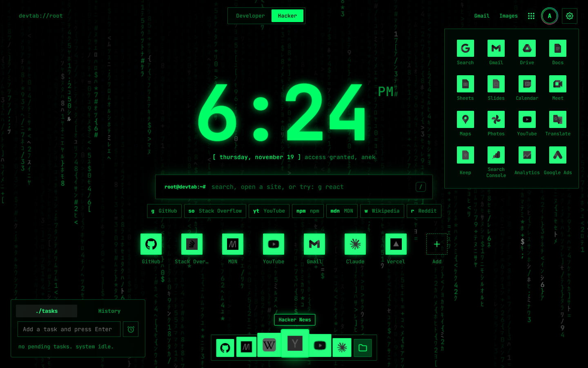
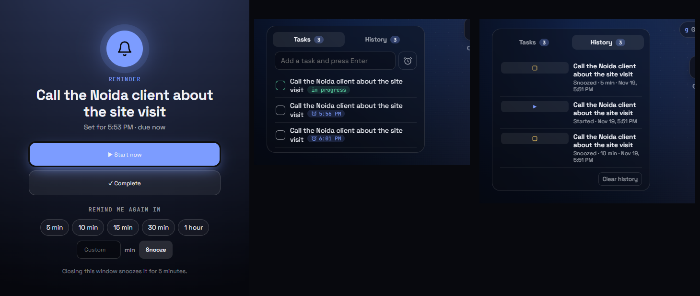
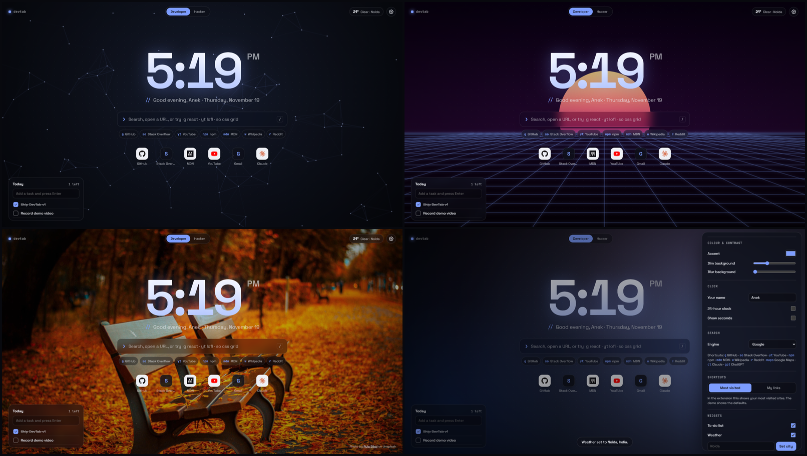

# DevTab

A new tab page for developers, with two looks: **Developer** and **Hacker**. Animated backgrounds that stay sharp on a 4K screen, or your own image or video. A search box that understands shortcuts, your own shortcuts with each site's real icon, a bookmarks dock, the weather, and tasks that ring when they're due.

**[Try the live demo →](https://anekkumar9518.github.io/devtab/)** (it runs in any browser; installing the extension makes it your new tab)


## Features

- **Two looks.** Developer: glass panels, a soft glowing clock, an aurora background. Hacker: green monospace, Matrix rain, a glitching clock, CRT scanlines and a short boot sequence. Each look keeps its own background, colour and dim level. Switch with the toggle at the top or <kbd>Alt</kbd>+<kbd>M</kbd>.
- **Backgrounds.**
  - Five animated scenes drawn live on a canvas at your screen's real resolution: Aurora, Constellation (it reacts to your cursor), Matrix rain, Starfield and Synthwave.
  - A random 4K photo, with credit to the photographer.
  - **Your own image or video:** MP4 and WebM loop silently.
  - A solid colour.
  - Plus dim and blur sliders and an accent colour picker.
- **Search with shortcuts.** Type a URL to open it, or a shortcut first: `g` GitHub, `so` Stack Overflow, `yt` YouTube, `npm`, `mdn`, `w` Wikipedia, `r` Reddit, `maps`, `cl` Claude, `gpt` ChatGPT. Everything else goes to your engine (Google, DuckDuckGo, Bing or Brave). Press <kbd>/</kbd> to focus the box, and <kbd>Ctrl</kbd>+<kbd>Enter</kbd> to open the result in a new tab.
- **Shortcuts.** Your most-visited sites, or your own list of up to 16. Tap **+**, paste any URL and give it a name: DevTab reads the site's own `<link rel="icon">` and uses it as the tile icon. Hover a tile and it tilts in 3D while a card types the URL out above it. Drag tiles to reorder; the pen and × buttons edit or remove them.
- **Bookmarks dock.** Your Chrome bookmarks in a dock at the bottom that magnifies under the cursor. Folders open as a grid (and folders inside folders), anything that doesn't fit sits behind a **+N** button, and it updates the moment you add a bookmark. Pick which folder it shows in Settings.
- **Google bar.** Gmail, Images, a grid of 16 Google apps (including Search Console, Analytics and Google Ads) and your account, styled to match each look. You can turn it off.
- **Tasks that ring.** Add a task, tap ⏰, pick +15 min, +1 hour, tomorrow 9 AM or any date and time, then tap **Set reminder**. When it's due, a ringtone loops, a window pops up over whatever you're doing, and a notification appears. Choose **Start now**, **Complete**, or **snooze** for 5, 10, 15 or 30 minutes, an hour, or a custom time. Closing the window snoozes it for 5 minutes, so nothing slips. This works on any tab, even when DevTab isn't open.
- **History** of everything you added, started, completed, snoozed or deleted, with pages.
- **Weather** for any city.
- **Private.** Settings, tasks and uploads stay in your browser. There are no accounts, no analytics and no remote code.








## Install

DevTab isn't on the Chrome Web Store yet, so you load it yourself. It takes a minute:

1. Download **[devtab-extension.zip](https://github.com/Anekkumar9518/devtab/releases/latest/download/devtab-extension.zip)** from the [latest release](https://github.com/Anekkumar9518/devtab/releases/latest) and unzip it.
2. Open `chrome://extensions` (or `edge://extensions`) and turn on **Developer mode**.
3. Click **Load unpacked** and pick the `devtab` folder.
4. Open a new tab. If Chrome asks whether to keep the change, choose **Keep it**.

**Optional: matching browser colours.** Get `devtab-theme-dev.zip` or `devtab-theme-hacker.zip` from the same release and load it the same way (Load unpacked) to recolour the tabs, toolbar and address bar.

## How it's built

Plain HTML, CSS and JavaScript modules. There's no framework and no build step.

```
newtab.html          the page Chrome opens for a new tab
css/style.css        both looks (Developer and Hacker)
js/app.js            clock, search, to-dos, weather, settings
js/links.js          shortcuts, the URL hover card, the bookmarks dock, the Google bar
js/backgrounds.js    the five animated canvas scenes
js/store.js          settings in chrome.storage, uploads in IndexedDB
js/tasks.js          tasks, reminders and history
background.js        alarms: rings, opens the alert window, shows the notification
alert.html           the "it's time" window (Start now / Complete / Snooze)
offscreen.html       plays the ringtone for the background worker
themes/              two Chrome themes that colour the browser frame
```

- **Backgrounds:** drawn on a `<canvas>` sized to `devicePixelRatio`, so they're crisp on any display. They pause when the tab is hidden and render one still frame for people who prefer reduced motion.
- **Uploaded videos:** stored as Blobs in IndexedDB. The extension asks for `unlimitedStorage` so a long video fits.
- **Most-visited sites** come from `chrome.topSites`, and icons from Chrome's built-in favicon cache. When Chrome has no cached icon, the site's own `favicon.ico` is used, and if that fails, a letter tile.
- **Site icons for your shortcuts:** when you save a shortcut, DevTab asks Chrome for permission to read that one site (an optional host permission, requested only then), fetches the page, picks the best `<link rel="icon">` or `apple-touch-icon`, and removes the permission straight away. If you say no, it falls back to Chrome's favicon cache.
- **Bookmarks** are read with `chrome.bookmarks`; DevTab never changes them.
- **Weather** comes from [Open-Meteo](https://open-meteo.com) (free, no key). **Photos** come from [Lorem Picsum](https://picsum.photos), which serves Unsplash images.

- **Reminders** use `chrome.alarms`, so they fire from the background worker even when no DevTab tab is open. The ringtone plays from an offscreen document, and the alert is its own small window, so it shows on top of any site. If Chrome was closed when a reminder was due, it rings the next time Chrome starts.
- Each Chrome profile (and each browser) runs its own copy of the extension. Reminders ring in the profile where you set them; install DevTab in another profile or browser to get reminders there.

Permissions: `storage`, `topSites`, `favicon`, `unlimitedStorage`, `alarms`, `notifications`, `offscreen` (for the ringtone) and `bookmarks` (read-only, for the dock). Site access is optional: it is asked for one site at a time when you save a shortcut, and removed right after.

## Credits

Fonts: [Space Grotesk](https://fonts.google.com/specimen/Space+Grotesk) and [JetBrains Mono](https://www.jetbrains.com/lp/mono/), both under the SIL Open Font License. Photos are by the Unsplash photographers credited on screen.

Made by [Anek Kumar](https://www.anekkumar.in). MIT licensed. Also see [AK Phone](https://github.com/Anekkumar9518/ak-phone), an Android-style phone that runs in a web page.
