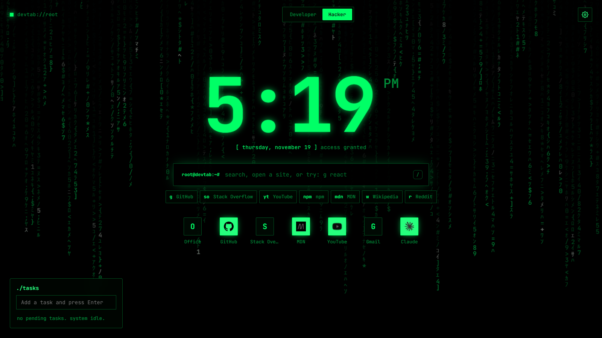

# DevTab

A new tab page for developers, with two looks: **Developer** and **Hacker**. Animated backgrounds that stay sharp on a 4K screen, or your own image or video. A search box that understands shortcuts, your most-visited sites, a to-do list and the weather.

**[Try the live demo →](https://anekkumar9518.github.io/devtab/)** (it runs in any browser; installing the extension makes it your new tab)




## Features

- **Two looks.** Developer: glass panels, a soft glowing clock, an aurora background. Hacker: green monospace, Matrix rain, a glitching clock, CRT scanlines and a short boot sequence. Each look keeps its own background, colour and dim level. Switch with the toggle at the top or <kbd>Alt</kbd>+<kbd>M</kbd>.
- **Backgrounds.**
  - Five animated scenes drawn live on a canvas at your screen's real resolution: Aurora, Constellation (it reacts to your cursor), Matrix rain, Starfield and Synthwave.
  - A random 4K photo, with credit to the photographer.
  - **Your own image or video:** MP4 and WebM loop silently.
  - A solid colour.
  - Plus dim and blur sliders and an accent colour picker.
- **Search with shortcuts.** Type a URL to open it, or a shortcut first: `g` GitHub, `so` Stack Overflow, `yt` YouTube, `npm`, `mdn`, `w` Wikipedia, `r` Reddit, `maps`, `cl` Claude, `gpt` ChatGPT. Everything else goes to your engine (Google, DuckDuckGo, Bing or Brave). Press <kbd>/</kbd> to focus the box, and <kbd>Ctrl</kbd>+<kbd>Enter</kbd> to open the result in a new tab.
- **Shortcuts.** Your most-visited sites with their real icons, or your own list of links.
- **To-do list** and **weather** for any city.
- **Private.** Settings, tasks and uploads stay in your browser. There are no accounts, no analytics and no remote code.


## Install

DevTab isn't on the Chrome Web Store yet, so you load it yourself. It takes a minute:

1. Download **[devtab-extension.zip](https://github.com/Anekkumar9518/devtab/releases/latest/download/devtab-extension.zip)** from the [latest release](https://github.com/Anekkumar9518/devtab/releases/latest) and unzip it.
2. Open `chrome://extensions` (or `edge://extensions`) and turn on **Developer mode**.
3. Click **Load unpacked** and pick the `devtab` folder.
4. Open a new tab. If Chrome asks whether to keep the change, choose **Keep it**.

**Optional: matching browser colours.** Get `devtab-theme-dev.zip` or `devtab-theme-hacker.zip` from the same release and load it the same way (Load unpacked) to recolour the tabs, toolbar and address bar.

## How it's built

Plain HTML, CSS and JavaScript modules. There's no framework and no build step.

```
newtab.html          the page Chrome opens for a new tab
css/style.css        both looks (Developer and Hacker)
js/app.js            clock, search, shortcuts, to-dos, weather, settings
js/backgrounds.js    the five animated canvas scenes
js/store.js          settings in chrome.storage, uploads in IndexedDB
themes/              two Chrome themes that colour the browser frame
```

- **Backgrounds:** drawn on a `<canvas>` sized to `devicePixelRatio`, so they're crisp on any display. They pause when the tab is hidden and render one still frame for people who prefer reduced motion.
- **Uploaded videos:** stored as Blobs in IndexedDB. The extension asks for `unlimitedStorage` so a long video fits.
- **Most-visited sites** come from `chrome.topSites`, and icons from Chrome's built-in favicon cache. When Chrome has no cached icon, the site's own `favicon.ico` is used, and if that fails, a letter tile.
- **Weather** comes from [Open-Meteo](https://open-meteo.com) (free, no key). **Photos** come from [Lorem Picsum](https://picsum.photos), which serves Unsplash images.

Permissions: `storage`, `topSites`, `favicon`, `unlimitedStorage`. That's all.

## Credits

Fonts: [Space Grotesk](https://fonts.google.com/specimen/Space+Grotesk) and [JetBrains Mono](https://www.jetbrains.com/lp/mono/), both under the SIL Open Font License. Photos are by the Unsplash photographers credited on screen.

Made by [Anek Kumar](https://www.anekkumar.in). MIT licensed. Also see [AK Phone](https://github.com/Anekkumar9518/ak-phone), an Android-style phone that runs in a web page.
