# DevTab

A new tab page for developers, with two looks: **Developer** and **Hacker**. Control the web with your hands like Iron Man, or with just your face. Scan any website's code and steal a component, and spy on prices. A live sky with your city's real weather, your GitHub year as a 3D city, a clock made of particles, and a page that falls apart when you shake the mouse. Plus the useful stuff: focus mode that blocks distracting sites, ambient sounds, workspaces, a browsing Wrapped, a tab pet, page tools (colour picker, image size and font finder, image and video downloader), shortcuts with real site icons, a bookmarks dock, and reminders that ring.

**[Try the live demo →](https://anekkumar9518.github.io/devtab/)** (it runs in any browser; installing the extension makes it your new tab and unlocks the features that need it)

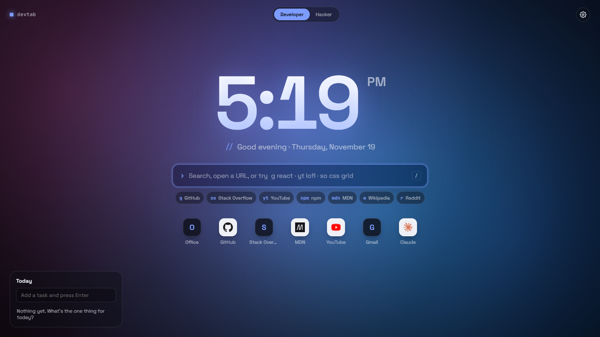


## What's new in 4.0

### 🌀 3D tab carousel
Hold your open palm still and every tab in the window spreads out in a 3D ring with a live picture of each page. Move your hand to spin it, pinch to jump to a tab, close your fist to put it away. Works with the mouse wheel and arrow keys too.

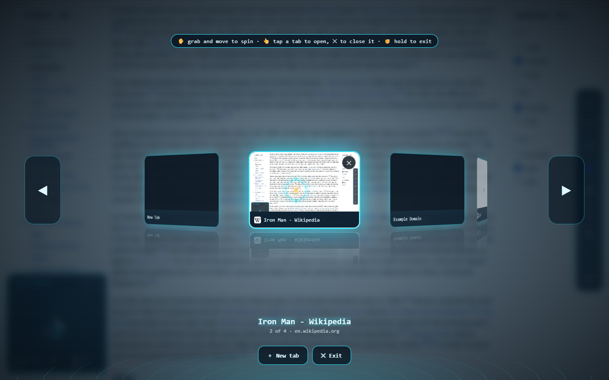

### ✏️ Air drawing
Make the 🤟 sign (or press ✏ in the dock) and your index finger becomes a neon pen: pinch to draw over any page. Pick a colour, undo, clear, and **Save** a screenshot of the page with your drawing to Downloads.

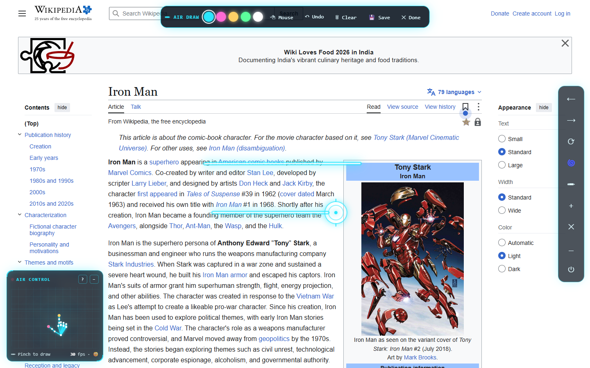

### 🖐️ Your own gestures
In Hub → Air control → **Your own gestures**, show a hand pose three times and give it a job: go to the top, open a site, take a screenshot, mute the tab, start Focus, play sounds and more. DevTab checks your new pose isn't too close to one you already have, and shows a live "✅ Recognised" readout so you can test it.

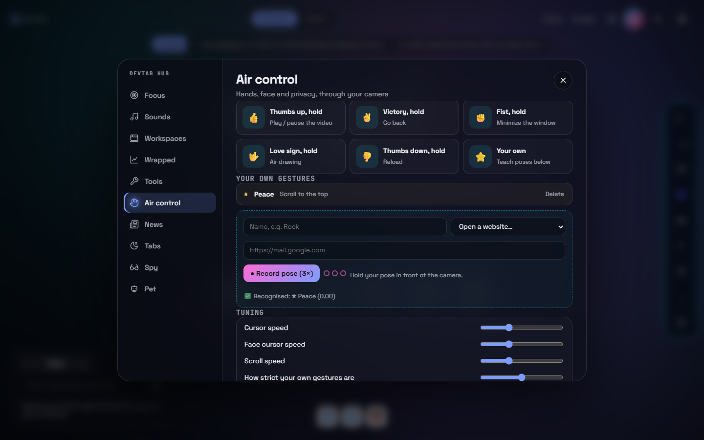

### 🙂 Hands-free with your face only
Switch on **Face control** and a cursor follows your nose. **Wink** to click, raise your **eyebrows** to scroll down and open your mouth to scroll up, **tilt your head** to switch tabs, and **smile** to play or pause.

### 🛡️ Shoulder-surfer shield and Away mode
With the **shield** on, the page blurs the moment a second face appears behind you, and clears when they're gone. **Away mode** blurs the screen and mutes every tab when you've left your desk (after 1 minute, or what you pick), and unlocks as soon as your face is back. Face tracking runs on your computer; no image leaves it.

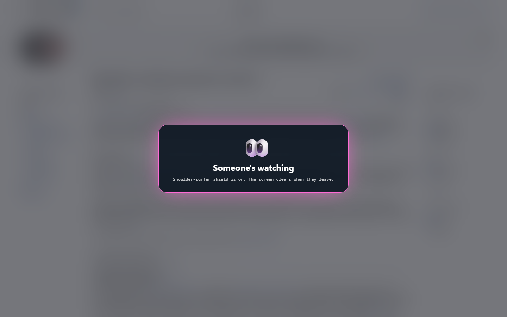

### 🐾 The pet eats ads and evolves
On websites, the pet hunts down ad slots and munches them ("Nom nom… 🍪"), and the Pet pane counts every ad eaten. It also grows up: finishing tasks and focus sessions, eating ads, petting it and visiting daily earn XP. The robot goes Bot → Bot+ → Mech → Jet Mech → Titan, and the cat goes Kitten → Bell cat → Ninja cat → Blade ninja → Shadow master, with new gear at every level and powers on websites (the ninja cat teleports in a puff of smoke, the Jet Mech rocket-jumps).

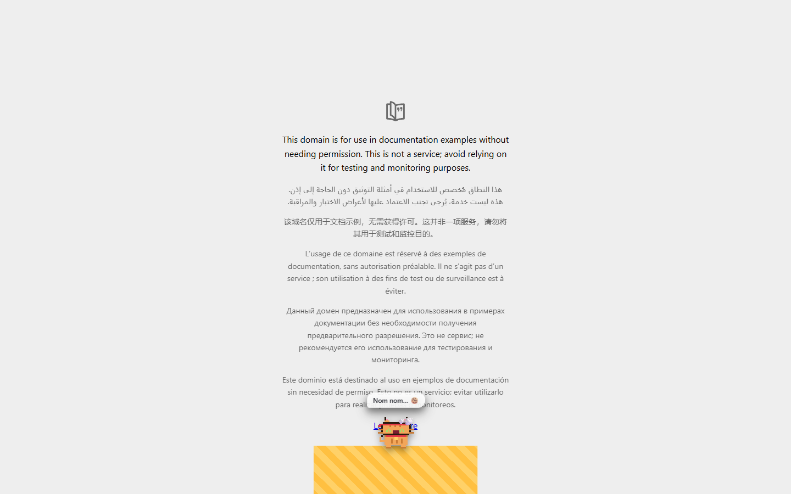

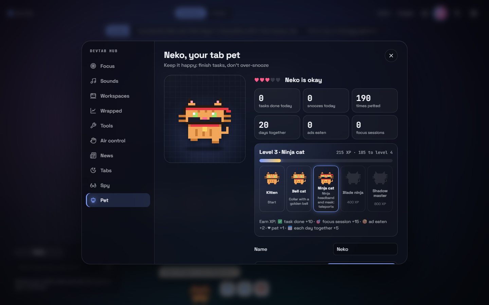

### 🩻 Website X-ray: steal any component
From the toolbar button, hover anything on a page for a holographic scan: tag and classes, size, margin and padding, font, colours and layout. <kbd>↑</kbd> / <kbd>↓</kbd> walk to the parent or child. Click to pin it, and **Steal component** rebuilds that part as clean, standalone HTML + CSS (only the styles that matter, shorthand CSS, sprite icons pulled in, absolute links), with a live preview. Copy it or download it as an `.html` file.

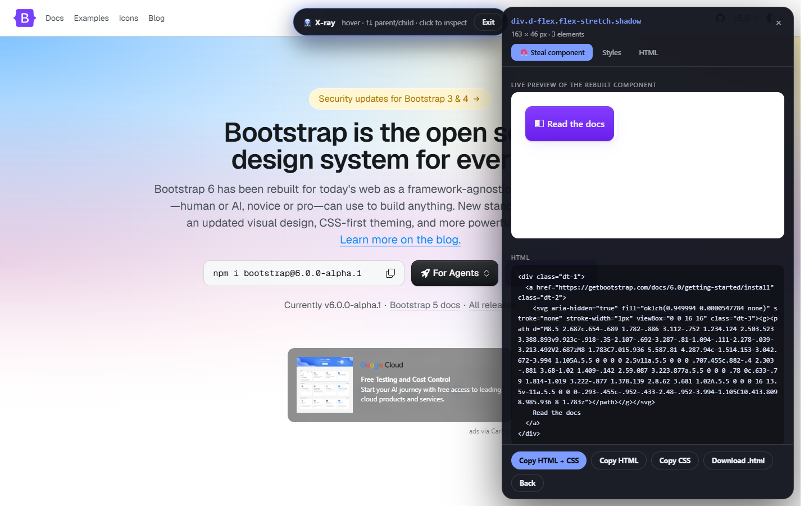

### 🕵️ Price & change spy
Open a product page or a competitor's site, pick **Price & change spy** from the toolbar button, and click the price or any text (or watch the whole page). On most shops DevTab spots the price for you. It then checks in the background (every 1 to 24 hours) and sends a notification when it changes: *"💰 Price dropped 13.7%: £60 → £51.77"*. The Spy pane in the Hub shows every watch with a price graph, lowest and highest price, and what the text said before. Checks run in your own browser, so you see your own prices; pages that build themselves with JavaScript are read in a muted background tab for a few seconds.

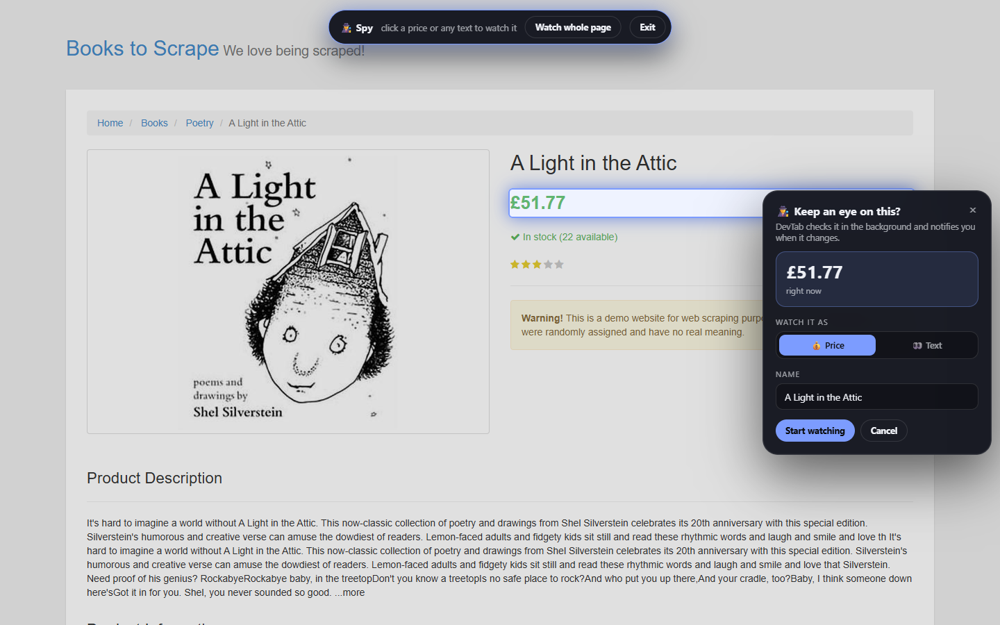

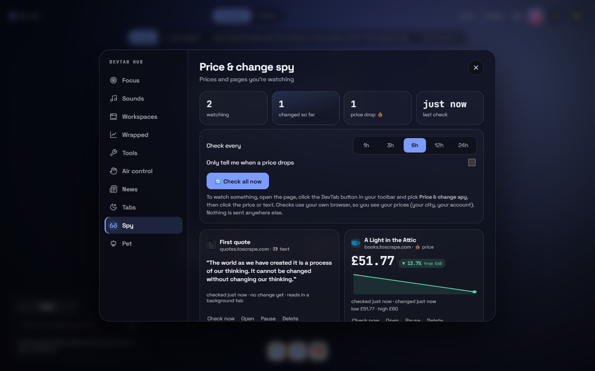

## What's new in 3.0

### ✋ Air control: your hands are the mouse
Turn it on in the Hub and your webcam becomes a controller on **every tab**. Hand and face tracking run on your computer with Google's MediaPipe models, bundled inside the extension. The camera image never leaves your machine.

| Gesture | Does |
| --- | --- |
| ☝️ Point | Moves a holographic cursor that locks onto links and buttons |
| 🤏 Pinch | Click (pinch twice to double-click) |
| 🤏 Pinch + move | Drag the page |
| ✋ Palm up / down | Scroll |
| ✋ Palm swipe left / right | Previous / next tab |
| ✋ Palm held still | All your tabs in a 3D carousel |
| 👍 Thumbs up (hold) | Play / pause the video |
| ✌️ Victory (hold) | Go back |
| ✊ Fist (hold) | Minimize the window |
| 🤟 Love sign (hold) | Air drawing |
| 👎 Thumbs down (hold) | Reload |
| 🙂 Look away | The video pauses, and plays again when you look back |

Hold gestures fill a ring first, so nothing fires by accident. A HUD panel shows your tracked hand, and a side dock (Back, Forward, Reload, New tab, Close tab, Minimize) can be "air-clicked" too.

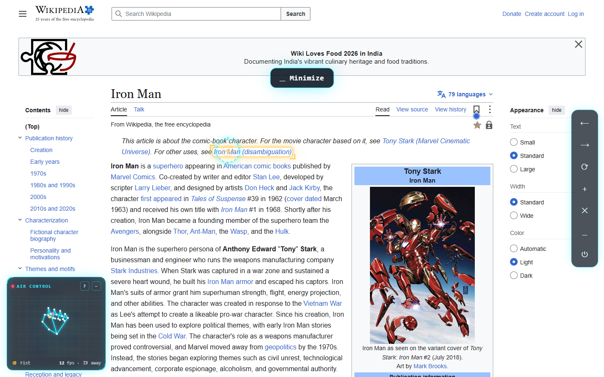

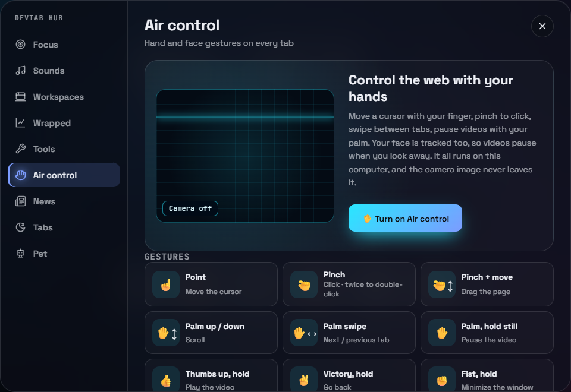

### 🐾 Your pet visits every website
Switch on "Take Bit to every website" and your pet comes along. It stands on headings, jumps between images and buttons, follows them as you scroll, naps on search bars and runs from your cursor. Click it for hearts, throw it, or press × to keep it off a site.

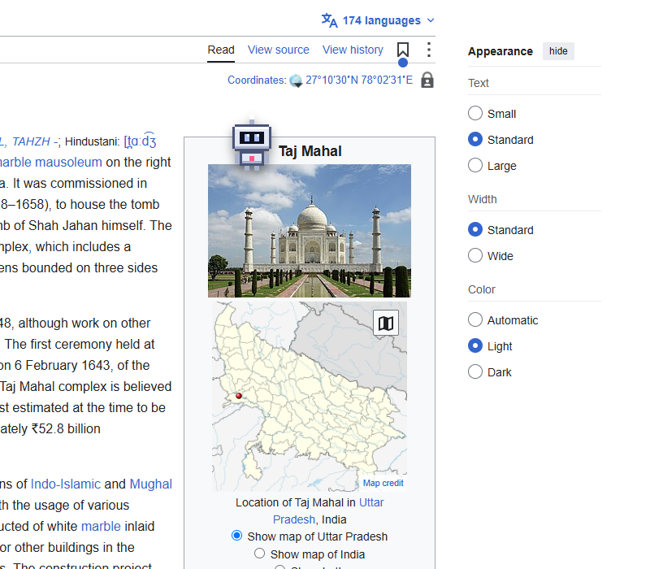

### ⏳ Website time machine
From the toolbar button (or the Hub's Tools), see how any site looked in every year since 1996. Bars show how often the Internet Archive saved it each year, and you can "Play the years" as a time-lapse or compare **Then vs now** side by side. Years before a site existed say so: *"In 2003, flipkart.com didn't exist yet. It first appeared on the web on 8 Jun 2007."*

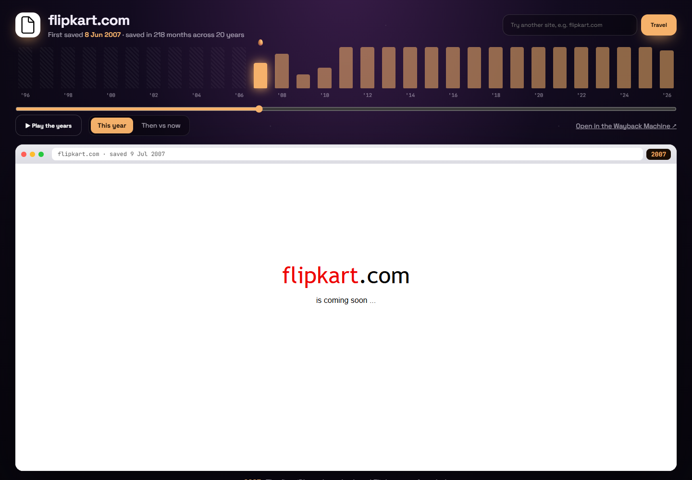

### 🧬 Tech stack detector
See what any site is built with: CMS (WordPress, Shopify, Wix…), framework (React, Next.js, Vue, Angular…), analytics and ad tags (Google Analytics and Tag Manager IDs, Meta Pixel, Google Ads, Hotjar, Clarity…), hosting (Cloudflare, Vercel, Netlify, Hostinger…), payments, chat widgets and SEO plugins, with versions where available. "Copy report" puts it all on your clipboard for client and competitor notes.

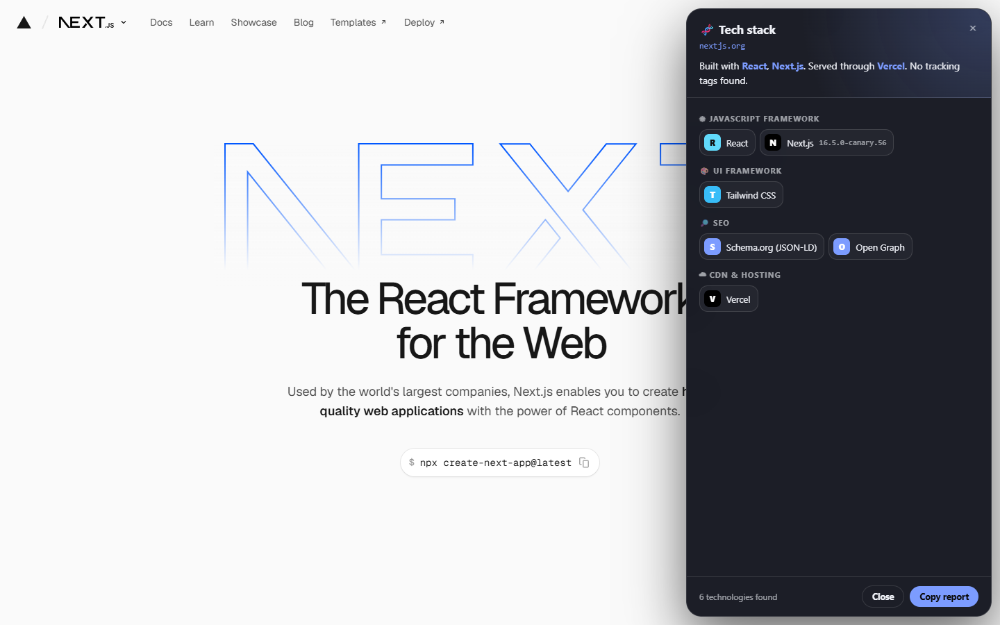

### 📸 Full-page screenshot with an editor
Captures the whole page, not just the screen (sticky headers are hidden after the first screen so they don't repeat). Then mark it up with arrows, boxes, pen, highlighter, text, **blur** for private details, and crop. Undo/redo, download as PNG or copy.

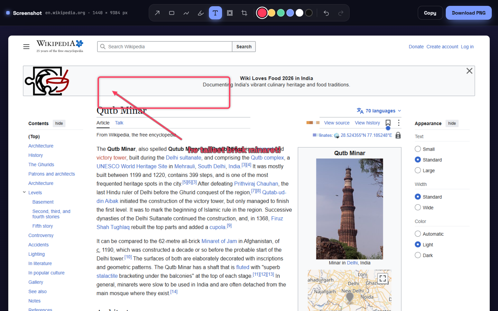

### 💤 Tab sleeper
Tabs you haven't used for a while (15 min to 2 h, or off) go to sleep and give their memory back; they reload when you click them. Tabs playing sound are never put to sleep, and pinned ones can stay awake. The Tabs pane shows everything open, finds duplicates and closes them in one click, and can put every other tab to sleep right away.

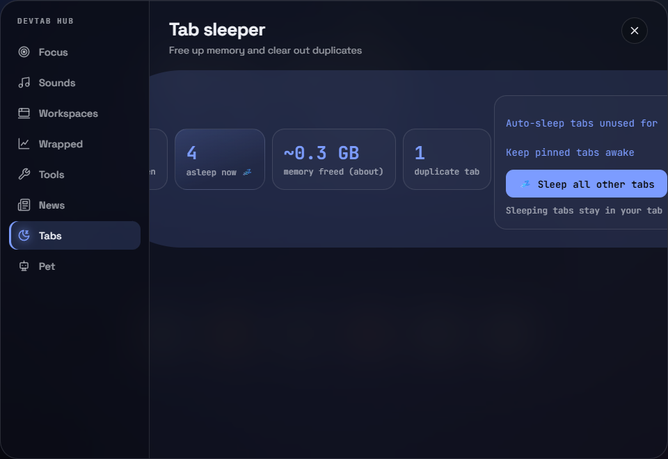

### 📰 News
India, World, Tech and AI headlines (Google News, with a हिन्दी option), plus Hacker News, GitHub trending and dev.to, in the Hub, with a scrolling headline ticker on the new tab.

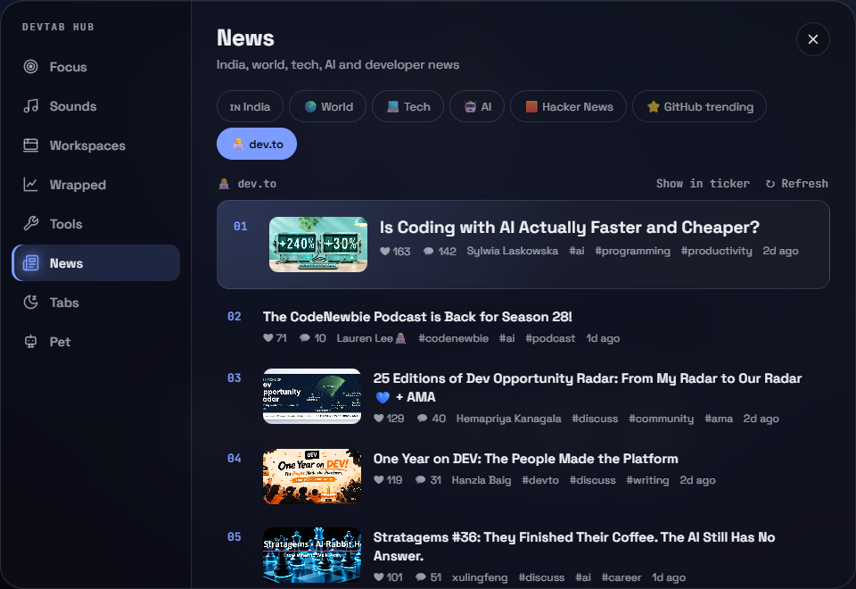

## What's new in 2.0

### Backgrounds that are alive
- **Live sky.** The real weather and the real sun for your city. Rain streaks and drops sliding down the glass, snow, fog, lightning in a thunderstorm, clouds that drift with the actual wind. The sky follows the real sunrise and sunset, with stars and a moon at night and lit windows in the city skyline.
- **Time travel.** Drag the slider and the sky moves through the day: dawn, noon, sunset, midnight. Let go and it glides back to now.
- **GitHub city.** Your last year of contributions as a night skyline: every day is a building, and busier days are taller. It turns slowly, and pointing at a building lights it up with "May 10, 2026: 20 contributions".
- **3D parallax.** Every background shifts in layers as you move the mouse (or tilt your phone), like a window into another world.


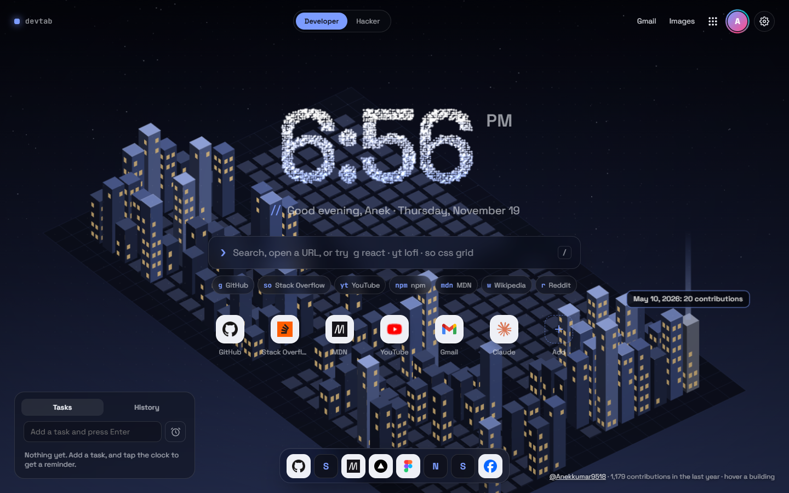

### Effects
- **Particle clock.** The digits are thousands of glowing dots. Move the cursor through them and they scatter like sand, then flow back. In the Hacker look they're falling Matrix characters.
- **Gravity mode.** Shake the mouse hard, or type `gravity`, and the whole page falls down. Grab things and throw them; they bounce and tumble. Double-click and everything flies back.
- **Launch scenes.** Opening a site plays a 0.7-second scene: a play button rushing past for video sites, contribution squares for GitHub, an envelope for mail, a warp tunnel with the site's icon for anything else. Type just `youtube`, `github` or the name of one of your shortcuts to open it.

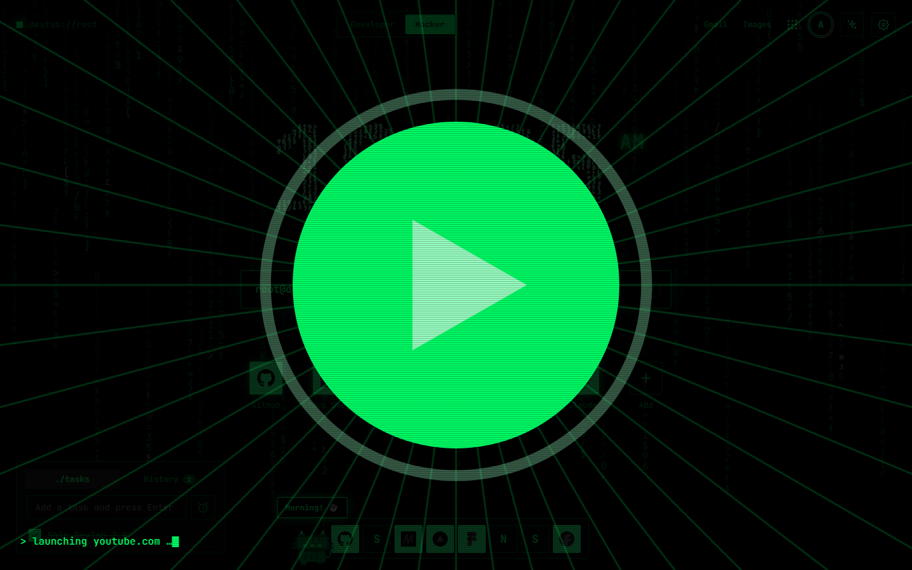

### The Hub (press <kbd>H</kbd> or <kbd>Ctrl</kbd>+<kbd>K</kbd>)
- **Focus mode.** Pick 15 to 90 minutes (or any length) and start. YouTube, Instagram and the other sites on your list turn into an "Access denied" page until the timer ends, with a countdown badge on the toolbar icon. Ending early takes a deliberate 2.5-second hold.
- **Ambient sounds.** Rain, café, keyboard, server room, ocean waves and a fireplace, generated live in the browser (nothing is downloaded), each with its own volume. Ready-made mixes and a sleep timer. It keeps playing on every tab until you pause it.
- **Workspaces.** Save all the tabs in a window as "Client work" or "Learning", then reopen the whole set in one click.
- **Wrapped.** Tabs opened, time per site, your busiest hour, longest focus session and tasks done, for today, 7 or 30 days, and a shareable card. Opt-in, and it never leaves your browser.
- **Tools.** A colour picker that works anywhere on your screen, and an image inspector you can drop files on.
- **Your pet.** See how it's doing, rename it, or switch between the robot and the cat.

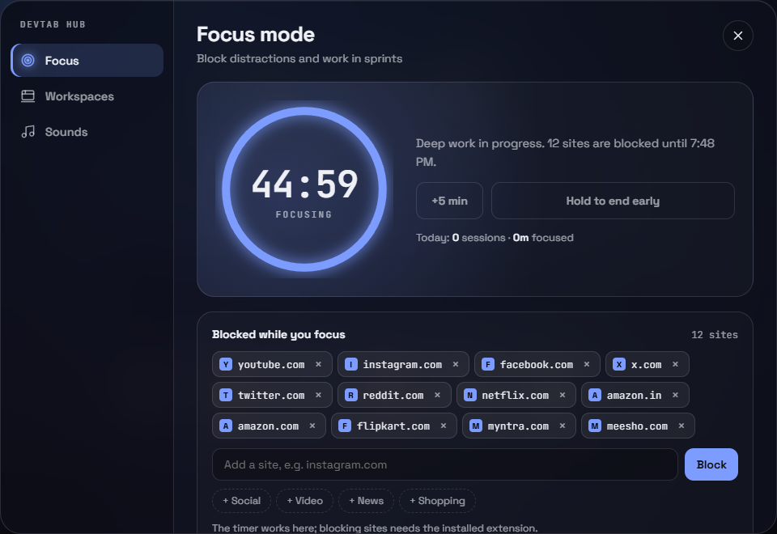

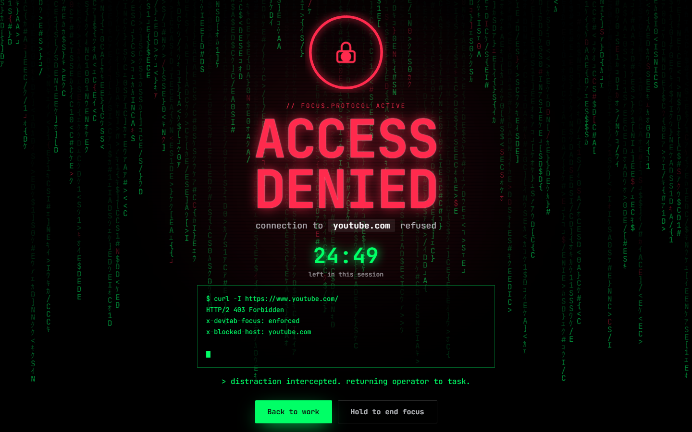

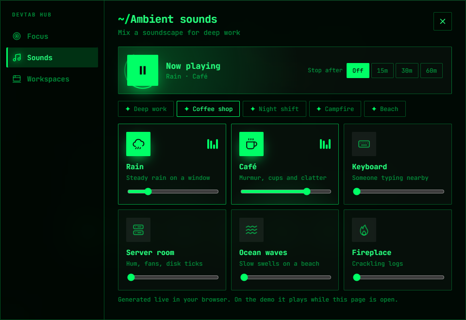

### Your tab pet
A pixel robot (or cat) lives at the bottom of the page. It walks around, naps on the clock, sleeps at night, watches your cursor, cheers when you complete a task and sulks when you snooze. Leave it for days and it gets dusty; click it to clean it. You can pick it up and throw it.


### "What was I doing?"
After Chrome restarts, the first new tab shows what you were working on last time (your in-progress task, or the page you were on) and brings all your tabs back in one click.

### Page tools, on any website
Click the DevTab button in the toolbar for all seven (colour picker, image size, font finder, media downloader, tech stack, full-page screenshot, time machine), or use a shortcut:
- <kbd>Alt</kbd>+<kbd>Shift</kbd>+<kbd>1</kbd> **Colour picker:** the page freezes, a magnifier follows the cursor, and a click copies the exact pixel's HEX with RGB, HSL and a palette.
- <kbd>Alt</kbd>+<kbd>Shift</kbd>+<kbd>2</kbd> **Image size finder:** hover any image (even CSS backgrounds) to see its real resolution next to the size it's shown at, whether it's blurry or oversized, its format, file size and alt text. "All images" lists every image on the page, largest first.
- <kbd>Alt</kbd>+<kbd>Shift</kbd>+<kbd>4</kbd> **Media downloader:** every image on the page (the largest version from `srcset`, CSS backgrounds, inline SVGs and the share image) in a grid you can filter by size and type, then download one, a selection, or all of them into `Downloads/<site>/`. The Videos tab lists every video the site serves as a file (MP4, WebM, MOV…) with its resolution and length. Videos on YouTube, Netflix, Instagram and other streaming services stream in protected pieces and their terms don't allow downloading, so DevTab says so instead of saving them.
- <kbd>Alt</kbd>+<kbd>Shift</kbd>+<kbd>3</kbd> **Font finder:** hover text to see the font that's actually rendered (not just the CSS list), its size, weight, line height and colour, with a live sample and "Copy CSS".


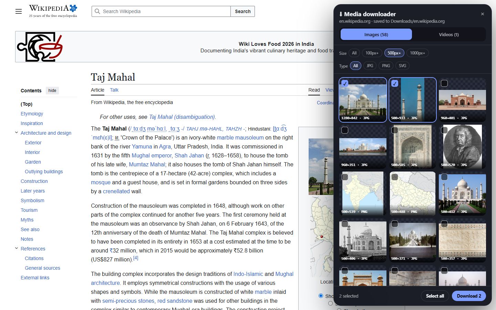

Everything above can be switched on or off in Settings.

## Everything else
- **Two looks.** Developer: glass panels, a soft glowing clock, an aurora background. Hacker: green monospace, Matrix rain, a glitching clock, CRT scanlines and a short boot sequence. Each look keeps its own background, colour and dim level. Switch with the toggle at the top or <kbd>Alt</kbd>+<kbd>M</kbd>.
- **Backgrounds.** Seven animated scenes drawn at your screen's real resolution (Aurora, Constellation, Matrix rain, Starfield, Synthwave, Live sky, GitHub city), a random 4K photo, your own image or video (MP4 and WebM loop silently), or a solid colour. Plus dim and blur sliders and an accent colour picker.
- **Search with shortcuts.** Type a URL to open it, or a shortcut first: `g` GitHub, `so` Stack Overflow, `yt` YouTube, `npm`, `mdn`, `w` Wikipedia, `r` Reddit, `maps`, `cl` Claude, `gpt` ChatGPT. Everything else goes to your engine (Google, DuckDuckGo, Bing or Brave). Press <kbd>/</kbd> to focus the box.
- **Shortcuts.** Your most-visited sites, or your own list of up to 16. Tap **+**, paste any URL and give it a name: DevTab reads the site's own `<link rel="icon">`. Hover a tile and it tilts in 3D while a card types the URL out. Drag to reorder.
- **Bookmarks dock** that magnifies under the cursor, with folders and a **+N** overflow. **Google bar** with Gmail, Images, a 16-app grid and your account.
- **Tasks that ring.** Pick a time and a ringtone loops, a window pops up over whatever you're doing, and a notification appears: **Start now**, **Complete** or **snooze**. Works on any tab, even when DevTab isn't open. With a full, paginated **history**.
- **Weather** for any city.
- **Private.** Settings, tasks, stats and uploads stay in your browser. No accounts, no analytics, no remote code.

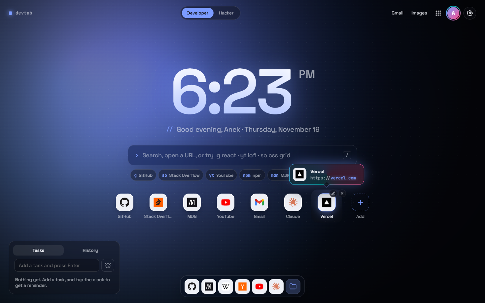


## Install

DevTab isn't on the Chrome Web Store yet, so you load it yourself. It takes a minute:

1. Download **[devtab-extension.zip](https://github.com/Anekkumar9518/devtab/releases/latest/download/devtab-extension.zip)** from the [latest release](https://github.com/Anekkumar9518/devtab/releases/latest) and unzip it.
2. Open `chrome://extensions` (or `edge://extensions`) and turn on **Developer mode**.
3. Click **Load unpacked** and pick the `devtab` folder.
4. Open a new tab. If Chrome asks whether to keep the change, choose **Keep it**.
5. Pin the DevTab button (🧩 menu → 📌) for the page tools.

Updating: replace the folder with the new one and press the reload button on the extension's card.

**Optional: matching browser colours.** Get `devtab-theme-dev.zip` or `devtab-theme-hacker.zip` from the same release and load it the same way to recolour the tabs, toolbar and address bar.

## How it's built

Plain HTML, CSS and JavaScript modules. There's no framework and no build step; the only library is [matter.js](https://brm.io/matter-js/) for gravity mode, bundled locally.

```
newtab.html            the new tab page
js/app.js              clock, search, tasks, weather, settings
js/backgrounds.js      the canvas scenes; js/scenes/ has the live sky and the GitHub city
js/fx/                 particle clock, gravity, launch scenes, pet, "what was I doing?"
js/hub.js, js/panes/   the Hub and its panes: focus, sounds, workspaces, wrapped, tools
js/ambient-engine.js   the sound generator (Web Audio)
js/inject/             the page tools (injected only when you start one: X-ray, spy picker, colour picker…), Air control's HUD and the pet on websites
js/air-engine.js       hand and face tracking (MediaPipe, bundled in js/vendor/mediapipe)
time.html, shot.html   the time machine and the screenshot editor
background.js, js/bg/  reminders, focus blocking, the audio page, Wrapped tracking, tools
blocked.html           what a blocked site turns into during focus
popup.html             the toolbar button
```

- **Live sky:** weather, cloud cover, wind, sunrise and sunset from [Open-Meteo](https://open-meteo.com) (free, no key), refreshed every 20 minutes and drawn in the city's own time.
- **GitHub city:** your public contribution calendar, read straight from github.com once you allow it (or from the public [github-contributions-api](https://github-contributions-api.jogruber.de) mirror if you don't). Turn on **Private contributions** in your GitHub profile settings to include private work.
- **Focus blocking** uses `webNavigation` to send matching sites to the blocked page. **Workspaces** and **"What was I doing?"** read your tabs' addresses with `tabs`. **Wrapped** adds up time per site with `tabs` and `idle`, stored only in `chrome.storage.local`.
- **Page tools** use `activeTab` + `scripting`, so DevTab can only get into a page when you click its button or press a shortcut. The colour picker takes one screenshot of the visible tab; the media downloader saves files with `chrome.downloads`.
- **Sounds and the ringtone** play from one offscreen document, because a background worker can't play audio. It closes when nothing is playing.
- **Air control** runs MediaPipe's gesture recognizer and face landmarker in the offscreen page, reading camera frames straight from the video track, and sends only hand points and a gesture name to the tab you're looking at. Its content script and the pet's run on websites only after you switch them on and Chrome grants access to all sites.
- **Time machine** reads the Internet Archive's index of captures (one per month) and shows the snapshot nearest the middle of each year, in a sandboxed frame.
- **Tab sleeper** uses `chrome.tabs.discard`.
- **Face control, the shield and Away mode** use MediaPipe's face landmarker (blink, brow and mouth movements and head angle) in the same offscreen page; only those numbers reach your tabs.
- **Website X-ray** compares each element's computed styles with the browser's defaults and keeps only what differs.
- **Price & change spy** stores your watches in `chrome.storage.local` and checks them with `chrome.alarms`. It asks for access to just that one site when you add a watch, reads the page with your own cookies, parses it in the offscreen page, and falls back to a muted background tab for pages built with JavaScript. If a site shows a captcha, DevTab stops and tells you; it never tries to get past one.
- **Reminders** use `chrome.alarms`, so they fire even when no DevTab tab is open. If Chrome was closed when one was due, it rings when Chrome starts.
- Everything respects **reduced motion**: animated backgrounds show a still frame, and the particle clock, gravity, pet and launch scenes switch off.

Permissions: `storage`, `unlimitedStorage`, `topSites`, `favicon`, `bookmarks` (read-only), `alarms`, `notifications`, `offscreen`, `tabs`, `webNavigation`, `idle`, `scripting`, `activeTab` and `downloads` (to save the images and videos you pick). Host access to `news.google.com` (headlines) and `web.archive.org` (time machine). Access to all sites is optional, asked only when you turn on Air control, face features or the pet on websites; single-site access is asked when you save a shortcut (removed right after), connect GitHub, or add a site to the price & change spy. The camera is used only while Air control, face control, the shield or Away mode is on.

## Credits

Fonts: [Space Grotesk](https://fonts.google.com/specimen/Space+Grotesk) and [JetBrains Mono](https://www.jetbrains.com/lp/mono/), both under the SIL Open Font License. Physics: [matter.js](https://github.com/liabru/matter-js) (MIT). Hand and face tracking: [MediaPipe](https://github.com/google-ai-edge/mediapipe) (Apache 2.0). Website history: the [Internet Archive](https://archive.org). Photos are by the Unsplash photographers credited on screen.

Made by [Anek Kumar](https://www.anekkumar.in). MIT licensed. Also see [AK Phone](https://github.com/Anekkumar9518/ak-phone), an Android-style phone that runs in a web page.
